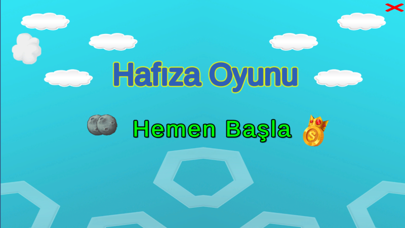

# Skor-Oyun

A hobby project: a static games page (HTML, CSS and a small script that switches the page text between Turkish and English) published with GitHub Pages at https://sthonem.github.io/Skor-Oyun/.
It currently hosts one game, Mind Game ("Hafıza Oyunu", a memory game), as a Unity WebGL build in `games/WebGLMindGame/`. The build files are not compressed, so the first load downloads about 62 MB. To run it locally, serve the repository root (for example `python3 -m http.server`) and open `games/WebGLMindGame/index.html`.

Türkçe: Hobi projesi; tarayıcıda oynanan oyunlar için statik bir sayfa. Şu an tek oyun var: Unity WebGL ile derlenmiş "Hafıza Oyunu" (Mind Game).
